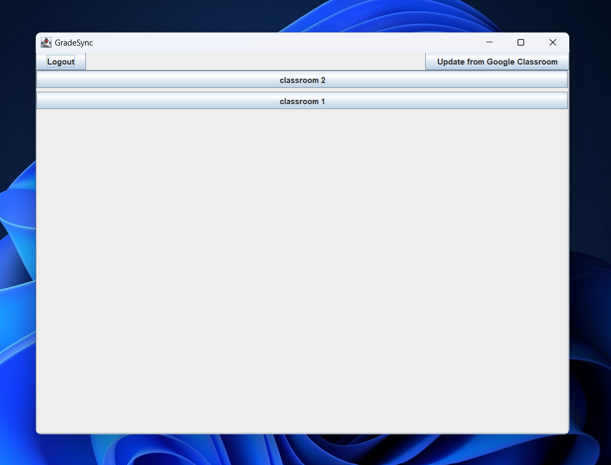
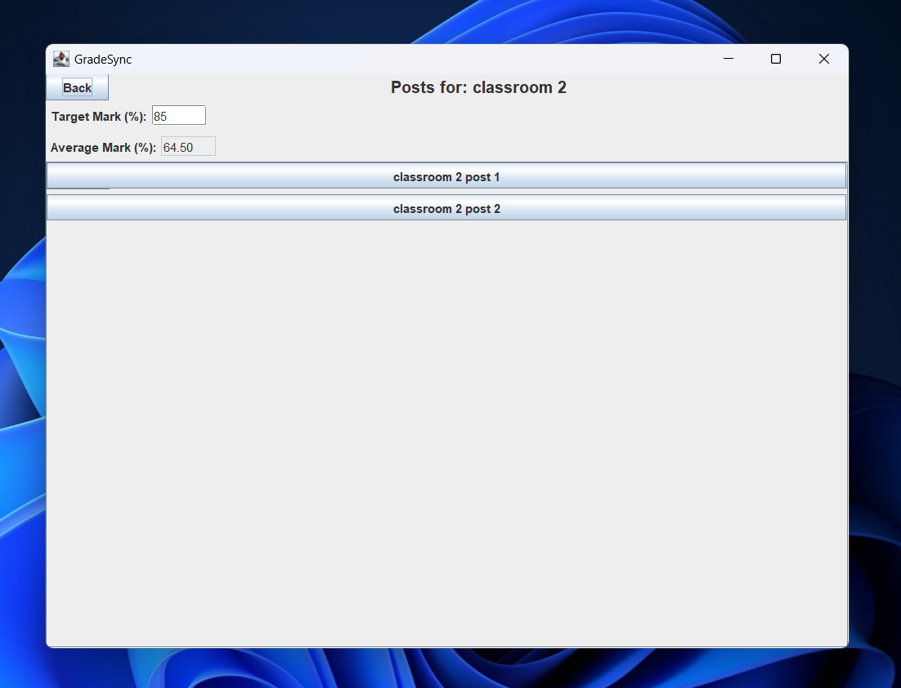
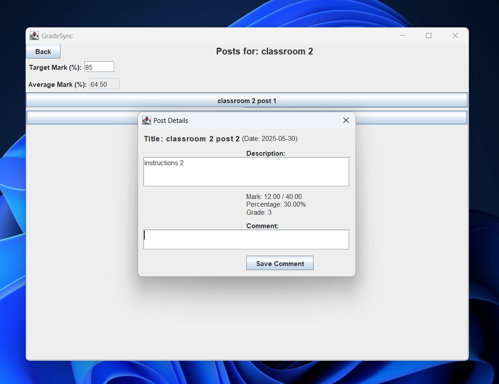
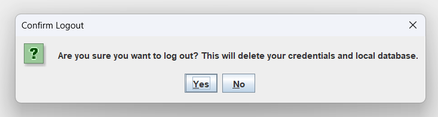

# GradeSync

GradeSync is a Java desktop application for reviewing Google Classroom coursework and grades in one place. It combines a Swing interface with the Google Classroom API and a local SQLite database.

## Features

- Sign in to Google using OAuth 2.0 and read courses, coursework, and the signed-in student's submissions from Google Classroom.
- View subjects and graded coursework in a Java Swing GUI, including marks, percentages, calculated grades, and subject averages.
- Set a target percentage for each subject and receive a desktop notification when a new grade arrives, a grade changes, or a target is reached.
- Add and save personal comments against coursework locally.
- Store application data in SQLite through JDBC.
- On Windows, create a Startup-folder script for background checks; the background process checks every 30 minutes.

## Screenshots

### Subject dashboard



### Subject overview



### Coursework details



### Logout confirmation



## Video Demo

[](https://www.youtube.com/watch?v=97DVD431Tmc)

## Technology

- Java 17
- Maven
- Java Swing
- Google Classroom API and OAuth 2.0
- SQLite and JDBC

## Development setup

### Prerequisites

- JDK 17
- Apache Maven
- A Google account with Google Classroom data to test against
- A Google Cloud OAuth client configured for a desktop application, with the Classroom API enabled

### OAuth configuration

The application looks for `/credentials.json` on the Java classpath. For local development, place your OAuth client file at:

```text
src/main/resources/credentials.json
```

Never commit this file, OAuth tokens, or account data. The app requests read-only access to Classroom courses and coursework. Its current code also reads the signed-in student's submissions to obtain assigned marks.

### Build and run on Windows

From the project root:

```powershell
mvn clean package
java -cp "target/GradeSync-1.0-SNAPSHOT.jar;target/lib/*" gradesync.Main
```

On first launch, the Google OAuth flow opens a browser so you can authorize access. Maven copies runtime dependencies into `target/lib` during packaging.

The database path is currently configured in `gradesync.Database` as `src/main/resources/gradesync.db`, relative to the project directory. The app creates the database and its tables if the file does not exist. Use a clean, private working copy and never commit a database populated with real Classroom information.

## Project structure

```text
src/main/java/gradesync/
  AuthManager.java       Google OAuth and Classroom client setup
  BackgroundUpdate.java  Scheduled sync and desktop notifications
  Database.java          Classroom data retrieval and SQLite persistence
  GUI.java               Swing interface
  Main.java              Application entry point
  models/                Subject and coursework data models
src/main/resources/      Local database and development-only OAuth config
```

## Scope and limitations

GradeSync is a personal/academic project. It is designed for an individual Google Classroom account and stores coursework data locally. It is not a multi-user service. The Windows startup integration is platform-specific. The current code uses a project-relative database path, so choose a private working directory and keep local data out of Git.
